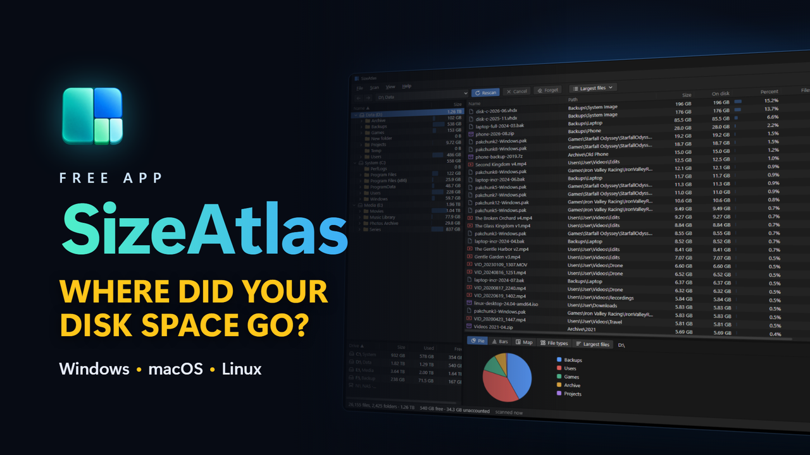
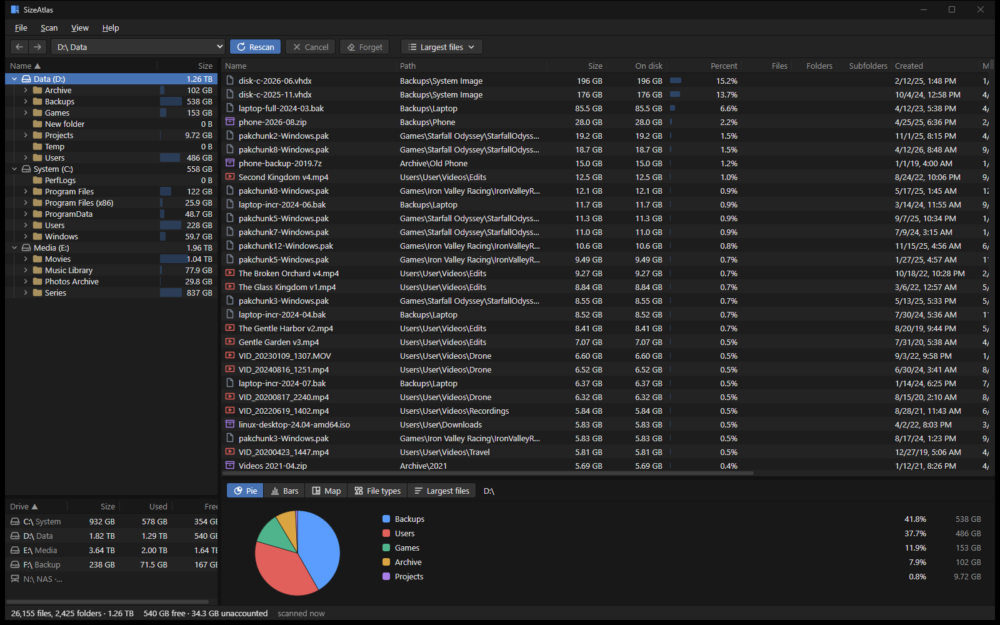
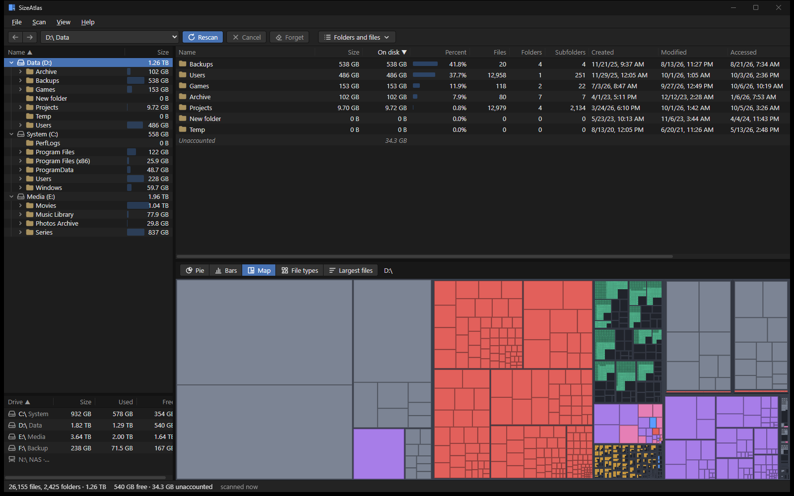

<h1> SizeAtlas</h1>



**Contents:** [What it does](#what-it-does) · [Install](#install) · [Languages](#languages) · [Using SizeAtlas](#using-sizeatlas) · [Benchmark](#benchmark) · [How sizes are counted](#how-sizes-are-counted) · [Moving to the trash](#moving-to-the-trash) · [Saved scans](#saved-scans) · [Updates](#updates) · [Building](#building) · [Releases](#releases) · [License](#license)

A cross-platform disk usage analyzer: see which folders and file types take up your disk space.

**Development notes, and a way to support the work if the app is useful to you:** 🤔😄🤗
[patreon.com/YGLabs](https://www.patreon.com/c/YGLabs).🤗



## What it does

> Work in progress.

- Scan drives and folders, and keep several of them side by side in one folder tree. The tree fills in while the first scan of a drive runs, and you can browse it meanwhile. Scans wait in a queue and run one at a time.
- See where the space goes: a sortable table of the current folder; lists of the largest, oldest, newest and empty items below it, and of the folders that grew most since the last scan; pie and bar charts, a treemap, file types and the largest files; free and unaccounted space of a drive.
- Refresh a single folder after a change, and move files and folders to the trash after a confirmation.
- Open items, show their properties and export the table to CSV. On Windows, restart as administrator to read every folder.
- The drives and folders that were open reopen at the next start.

Installers for Windows, macOS and Linux are on the [Releases](https://github.com/BeliyG3/SizeAtlas/releases) page.



## Install

Download the installer for your system from the [Releases](https://github.com/BeliyG3/SizeAtlas/releases) page. The installers are not signed, so the system warns you before the first start.

- **Windows:** the `.msi` or the setup `.exe`. If SmartScreen says that it protected your PC, click **More info**, then **Run anyway**. Smart App Control on Windows 11 blocks unsigned apps and shows no such button, so while it is on, the installer does not start.
- **macOS:** the `.dmg` for Apple silicon (`aarch64`) or Intel (`x64`); drag SizeAtlas to Applications. If macOS blocks the first start, open **System Settings › Privacy & Security** and click **Open Anyway**. If it says that the app is damaged, run `xattr -dr com.apple.quarantine /Applications/SizeAtlas.app`. To read every folder, SizeAtlas needs Full Disk Access; macOS resets it when you update an unsigned build, so grant it again after each update.
- **Linux:** the `.AppImage` (run `chmod +x` on it first; it may need `libfuse2`) or the `.deb`. Text in Chinese, Japanese, Korean, Thai, Hindi, Arabic and Hebrew may need the Noto fonts, which are the Debian/Ubuntu packages `fonts-noto` and `fonts-noto-cjk`.

| Platform | Status |
|---|---|
| Windows | Tested |
| macOS | Tested on the `.dmg` for Apple silicon (MacBook Air M2); the Intel build is untested |
| Linux | Untested |

**Versions** are calendar versions `YEAR.MONTH.N`. The first release of a month is shown as `2026.10`, the next ones as `2026.10.1`, `2026.10.2` and so on.

## Languages

The interface comes in 20 languages: Arabic, Chinese (Simplified), Dutch, English, French, German, Hebrew, Hindi, Indonesian, Italian, Japanese, Korean, Polish, Portuguese (Brazil), Russian, Spanish, Thai, Turkish, Ukrainian and Vietnamese. At the first start SizeAtlas follows the language of your system; change it in **View › Language**. Arabic and Hebrew use a mirrored, right-to-left interface, and Arabic shows numbers in Western digits. The translations are machine-made and were reviewed by several AI models. Corrections are welcome in [GitHub issues](https://github.com/BeliyG3/SizeAtlas/issues).

## Using SizeAtlas

- **Menu bar:** **File** has **Choose folder…**, **Export table** (see below) and **Exit**. **Scan** has **Scan** (the source picked on the toolbar), **Rescan** (the root of the selected folder, Ctrl+F5), **Refresh folder** (the current folder, F5; for the root it reads **Rescan**), **Cancel**, **Forget** and **Move to the trash…** (Delete). **View** has the size units (Auto, B, KB, MB, GB), **Drives panel** and **Chart**, which show or hide these panels, the theme (system, dark, light) and the language. **Help** has **About SizeAtlas**. Press Alt to move to the menu bar and back, or Alt and the underlined letter to open a menu. The arrow keys, Enter and Escape work in the menus, and while a menu is open, pointing at another title opens it.
- **Export:** **File › Export table** saves what the table on the right shows to a CSV file (UTF-8): every item of the current folder (not only the loaded rows) or the whole list, in the table's order, with a **Full path** column followed by the visible columns. Sizes, and **Before** and **Change** when shown, are in bytes (the change with its sign), and dates in local time. **CSV…** separates fields with commas, **CSV for Excel…** with semicolons, as Excel expects with Russian and other European regional settings. Ctrl+E repeats the last of the two. The "Unaccounted" row of a drive root is not exported. Excel treats a cell that starts with `=`, `+`, `-` or `@` as a formula, so be careful when you open an export of a folder whose file names you do not trust.
- **Toolbar:** open the source menu and pick a drive or a recent folder, then press the main button. It reads **Rescan** for the root of the selected folder, **Open** for another drive or folder in the tree or one with a saved scan, and **Scan** otherwise. **Choose folder…**, at the end of the source menu, scans any folder. Scans wait in a queue and run one at a time, and you can keep working while they run. **Cancel** stops the running scan, and **Forget** deletes the saved scan of the picked source, outdated ones included, and closes it if it is open.
- **Live first scan:** a root appears as soon as its top-level listing is read, with its own files and pending subfolders. Subfolders are scanned one at a time in name order, with a parallel walk inside each. Pending folders have no size; the current folder has a scanning marker and a growing size. Each completed folder becomes browsable with all its contents and final sizes. The tree and table update at most once every two seconds, and charts and the map at most once every five seconds; measured update cost can slow these intervals. Navigation and the final result remain immediate. You can browse, select, open items, copy paths and export during the scan. Refresh folder and Scan this folder are unavailable while a full scan of their root runs (first scan or rescan). Root files and completed folders can go to the trash during the scan; pending folders and the folder being scanned cannot. A queued rescan keeps the existing tree editable. Cancelling a first scan closes its partial tree without saving it; cancelling a rescan preserves the old complete tree. Only a completed scan is saved.
- **Back and forward:** the mouse side buttons, Alt+← and Alt+→ (on a Mac also Cmd+[ and Cmd+]), a two-finger swipe on a trackpad (right to go back, left to go forward; over a table that scrolls sideways, the swipe scrolls it until its edge first), or the arrows at the left of the toolbar go back and forward through the folders you visited, across roots; a folder of a root you closed is skipped, and a root that was rescanned opens at its top. In Arabic and Hebrew the directions are mirrored: Alt+→ and a swipe to the left go back, Alt+← and a swipe to the right go forward.
- **Left:** the folder tree and, below it, your drives with their size, used and free space. On Windows the list also has mapped network drives; one that does not answer is grayed out and shows **Disconnected** instead of sizes. Every drive or folder you open becomes a root of the tree, in the order you opened it, with a drive or folder icon. A root that is being scanned shows a spinner and the number of files found so far, and a root that waits for its turn shows **queued**. You can browse the other roots meanwhile, and a root you rescan stays as it was until the new scan replaces it. Right-click a root, or press Shift+F10, for **Rescan**, **Cancel scan**, **Close** (removes it from the tree and keeps its saved scan), **Forget** (deletes its saved scan and closes it), **Show in file manager** and **Copy path**. The tree lists folders only, sorted by name within each root until you click its Name or Size header (click again to reverse). Click the arrow next to a folder to expand or collapse it. Drag the tree's Name or Size header to swap the two columns. In the drives list, click a drive to select it and use the arrow keys to move. Double-click it or press Enter and a dialog asks what to do: **Scan** for a drive with no scan, **Open** or **Rescan** for a drive with a scan. A drive whose scan runs or waits is selected in the tree instead. Right-click a drive, or press Shift+F10, for **Scan** (**Rescan** if the drive has a scan), **Open** and **Forget**. Click a header of the drives list to sort it by that column (click again to reverse), and drag a header to move its column. Drag the border between the tree's Size and Name columns, or the border of the drives' Size, Used and Free columns on the side of the drive name, to resize them; double-click it to fit the column to its content.
- **Right:** the contents of the current folder. The table mode menu at the right of the toolbar picks what the table shows: the current folder (**Folders and files** or **Folders only**) or a list of everything below it: **Largest files**, **Largest folders** or both, **Grew most** (see below), **Oldest** and **Newest** files, folders or both by the date modified, **Empty** folders, zero-length files or both by path, **Unreadable folders** by path, and **Longest paths**. A list holds the first 1,000 items, with the folder of each, relative to the listed folder, in the **Path** column. Click an item to select it in the tree, double-click a folder or press Enter to list that folder instead, and press Backspace or Alt+↑ to list the folder above. A header click sorts the 1,000 items. Click anywhere in a column header to sort by it, and click again to reverse the order. In the current folder, the old rows stay on screen, dimmed, until the new order arrives. Drag the border on the right of a header to resize its column, or double-click it to fit the column to its header and the rows on screen. Drag a header left or right to move its column: a copy of the header follows the pointer and a line shows where it will drop (Name always stays first). Right-click the header for **Size column to fit**, **Size all columns to fit**, a list of columns to show or hide (Name cannot be hidden) and **Reset columns**, which restores the default order, widths and columns. The borders can also be reached with Tab: the arrow keys resize (Shift for bigger steps) and Enter fits. In the current folder, double-click a folder or press Enter to open it, and with the table focused, press Backspace or Alt+↑ to go up.
- **Refresh and trash:** after a change on disk, right-click a folder and choose **Refresh folder**, or press F5 for the current folder: only that folder is scanned again, in the queue, while the rest of the tree stays as it was and you can keep working. The refreshed folder and its parents stay expanded in the tree; folders inside it collapse. F5 on the root, or Ctrl+F5 anywhere, scans the whole root again. In the table and in lists, Ctrl+click adds or removes a row (on a Mac, Cmd+click works like Ctrl+click), Shift+click and Shift with the arrow keys select the rows from the last one you clicked, and Ctrl+A selects every loaded row (in a list, all of them). The selected rows clear when you select another folder or when the table mode, the sort or the tree changes. **Move to the trash…** in the context menu, Delete or **Scan › Move to the trash…** asks first: the dialog lists up to ten full paths, the total size and the date of the scan, and Cancel has the focus. In the tree, Delete moves the folder in focus. With several rows selected, the menu item reads **Move N items to the trash…** and **Copy paths** copies one path per line (with one row, the menu shows **Copy path**). SizeAtlas never deletes for good and has no undo: restore items from your system's trash, then refresh the folder. On a Mac keyboard without a Delete key, press Fn+Backspace.
- **What changed since the last scan:** after a full scan of a drive or folder (the first scan or **Rescan**), SizeAtlas compares it with the previous full scan of the same root, by the size on disk. The very first scan of a root has nothing to compare with. The table then has a **Change** column: `+12.4 GB` or `−3.1 GB`, **new** for an item that was not there, `?` for a folder that could be read in only one of the two scans, `≈` before a figure that is approximate (it includes such a folder, or one of the two scans has approximate sizes), and nothing when the size did not change. The column is shown by default only when the root has a previous scan; show or hide it like the others. **Grew most** in the table mode menu lists up to 1,000 folders below the listed folder with the largest change, up or down, with the **Before** and **Change** columns, sorted by change. A folder that is gone is tagged **deleted** (only the topmost one of a deleted tree); it cannot be opened or moved to the trash, and you can only copy its path. While the comparison runs, the list says so; without a previous scan, it says that instead, and a rescan fills it. The status bar adds when the previous scan was made. Refreshing a folder (F5 on a folder; F5 on the root is a **Rescan**) and moving items to the trash do not change what SizeAtlas compares with: that is always the previous full scan. So a file you moved to the trash through SizeAtlas shows as a shrinkage of its folder. Cancelling a scan changes nothing.
- **Open, Properties, Scan this folder:** the context menu of one item also has **Open** (a file opens in its default program, a folder in the file manager; double-click or Enter on a file does the same), **Properties** (the system dialog; Windows only) and, for a folder, **Scan this folder**, which queues a full scan of it as a new root of the tree. **Open** launches whatever the item is, programs included, so use it only on items you trust.
- **Bottom:** charts of the current folder, one at a time: **Pie**, **Bars**, **Map** (a treemap), **File types** and **Largest files**. Click a slice, bar or rectangle to select it: a folder opens, a file is selected in its folder. In **File types**, click a type to highlight its files in the map. The status bar shows the number of files and folders of the selected root, its size, for a drive its free and unaccounted space, and when the scan ran. While a scan runs, its right side shows the root, the files found so far and the folder being read.

Drag the borders between the panels to resize them. SizeAtlas remembers the open roots and the selected one, panel sizes, column widths, the order and visibility of the table columns, the order of the tree and drives columns, the drives sort, the table mode, whether the drives panel and the chart are shown, the chart, units, theme and language.

| Column | Meaning | Sortable |
|---|---|---|
| Name | Name of the folder or file | Yes |
| Path | In a list: the folder of the item, relative to the listed folder | In lists |
| Size | Combined length of the files, before rounding to disk space | Yes |
| On disk | Space the files take on disk (see below) | Yes (default, largest first) |
| Percent | Share of the current folder, on disk | Yes, like On disk |
| Before | In a list: the size on disk in the previous full scan | In lists |
| Change | Change of the size on disk since the previous full scan | Yes |
| Files | Files at any depth | Yes |
| Folders | Folders directly inside | No |
| Subfolders | Folders at any depth | Yes |
| Created, Modified, Accessed | Dates from the file system | Modified only |
| Attributes | Windows: `D` folder, `R` read-only, `H` hidden, `S` system, `A` archive, `C` compressed, `E` encrypted, `I` not indexed, `O` offline, `P` sparse, `L` link. macOS and Linux: permissions such as `drwxr-xr-x` | No |
| Owner | Account that owns the item | No |

In a list, every column except Created, Accessed, Attributes and Owner sorts.

SizeAtlas reads Created, Accessed, Attributes and Owner from the disk only for the rows on screen, and only while one of these columns is shown, so they appear a moment after you scroll. A dash means it could not read the value.

## Benchmark

```bash
cargo run -p sizeatlas-core --release --example scan -- <path> [--live] [--twice] [--edit]
```

`--live` measures first-scan batches and preallocated grafts; without it the parallel whole-root walker is measured. `--twice` keeps the first result in memory while scanning again, to measure peak memory of a rescan. `--edit` removes the largest folders until most of the tree is gone and compacts it, as a large trash or refresh does, saving the cache before and after. On the Windows machine below, compacting took 0.05 s and saving the cache 1.19 s.

Results of milestone M0 (release build, warm file system cache, no administrator rights):

| Machine | Scanned | Objects | Scan | Peak memory | Cache file | Cache load |
|---|---|---|---|---|---|---|
| Intel i9-13900K, Samsung 990 PRO 4 TB, Windows 11 (NTFS) | `C:\`, 3.5 TiB | 8.2 million | 18 s | 1.6 GiB | 86 MiB | 1.4 s |
| Apple M2, 8 GB RAM, macOS 27 (APFS) | `/`, 304 GiB | 1.8 million | 13 s | 0.5 GiB | 17 MiB | 0.16 s |

The first run on Windows, with a colder cache, took 26 s. For reference, WizTree 4.33, which reads the NTFS master file table directly and needs administrator rights, scanned the same drive in 23 s.

## How sizes are counted

SizeAtlas reports the space files take on disk. Folder totals of hard-linked files can differ between a first scan and a rescan; the root total is the same.

- **Windows:** file length rounded up to whole clusters. Compressed and sparse files count their allocated size.
- **macOS and Linux:** allocated blocks. A file with several hard links is counted once. Other mounted file systems are not entered.
- Files that exist only in the cloud (OneDrive on Windows, iCloud Drive on macOS) count as 0, and cloud-only folders are not opened.
- Symbolic links and junctions are never followed.

When you scan the root of a drive, SizeAtlas also shows its free space and the **unaccounted** space: space the drive reports as used that the scan did not find. It includes system files, folders you cannot read, the Windows Recycle Bin and, on macOS, other volumes of the same APFS container. Items you move to the trash keep their space until you empty the trash, so the unaccounted space grows meanwhile.

Known limitations:

- On Windows, a file with several hard links is counted once per name, so folders such as `C:\Windows\WinSxS` or package stores that use hard links can look larger than they are.
- On Windows, very small files stored inside the master file table are counted as one cluster.
- Folders you cannot read, such as `System Volume Information` without administrator rights, are not counted. From the banner you can restart SizeAtlas as administrator on Windows to rescan the root, or open the Full Disk Access settings on macOS; **Show** lists the unreadable folders of the root. As administrator, SizeAtlas also enables the backup privilege to read system folders; some may stay unreadable even then. On macOS, some system folders stay unreadable even with Full Disk Access, as macOS protects them from every app: the banner then says that access is on.
- Windows container layers (`ProgramData\Microsoft\Windows\Containers\Layers`) are skipped: they mostly mirror system files, and reading them through their filter driver made a full scan about five times slower.
- On macOS, APFS clones are counted once per copy.
- On Windows, files compressed with WOF (CompactOS, `compact /exe`) are counted at their full length, because Windows does not mark them as compressed in directory listings.
- On Linux, btrfs subvolumes that are not separately mounted are skipped, because each has its own device id.
- Every open root is kept in memory: a drive with about 8 million objects takes about 1.6 GiB, and a rescan briefly holds two trees. Close a root to free its memory.

## Moving to the trash

Before anything moves, SizeAtlas checks that every item is still what the scan saw: a file or a folder with the same date modified. If one of them changed, nothing moves and SizeAtlas asks you to refresh the folder (F5). Each item is checked again right before it moves. Known limits of this check:

- An item that changes between the check and the move still goes to the trash: the system takes a path, not the item the check saw. The gap is short, and you can restore the item from the trash.
- The check compares the type and the date modified, not a file id, so a copy put back in place with the same date passes it.
- Right after a change, the folder listing can lag behind the date of the item itself for a moment, so an item changed just before the scan may be reported as changed. Refresh the folder and try again.
- The listing can also keep the old date for longer: a file kept open for writing can show its old date as long as it stays open. Such an item passes the check, and you can restore it from the trash.

On Windows, SizeAtlas moves an item only where the Recycle Bin takes it:

- the item is on a fixed drive, and no policy turns the Recycle Bin off;
- the Recycle Bin of that drive is turned on;
- when Windows reports a size limit for that Recycle Bin, the item fits in it. SizeAtlas compares the limit with the larger of the size on disk and the length, so cloud-only and compressed files count in full.

A `subst` drive is judged by the real drive behind it. If SizeAtlas cannot read these settings, or Windows would delete the item for good, the item stays where it is and SizeAtlas says so. On macOS, a volume without a trash is expected to report an error for each item.

While items move to the trash, scans wait; with many items this can take minutes on Windows. During a first scan, root files and completed folders can go to the trash, but pending folders and the folder being scanned cannot. During a rescan, the old tree stays editable: an item the rescan listed before it went to the trash is left out of the new tree. While a folder is refreshed, neither the folder, nor anything inside it, nor the folders above it can go to the trash; the rest of the root can. While a drive or folder has its first scan, the items of another open root inside it cannot go to the trash either. Where the trash is unavailable, the menu item is disabled and its tooltip says why, and a selection that includes such an item does not go at all. A rescan waiting in the queue keeps its existing tree editable. Closing the window while items move waits for the item that is moving and saves the scan; the items left stay where they are.

While items move, the status bar shows how many have gone and the name of the item that moves now, and their rows are dimmed. A request of more than 20 items also shows a small progress window that leaves the rest of the app usable. **Stop** (in that window, or in the status bar for a few items) ends the request after the item that is moving: the items moved so far stay in the trash and leave the tree, the rest stay where they are. A message then says how many items went and their size, or where Stop left the request. You can keep browsing meanwhile; another trash request and refreshing a folder of the same root are unavailable until it ends, and their tooltips say so.

## Saved scans

SizeAtlas saves each scan to the app data folder. At the next start it reopens the drives and folders that were open, in the same order, and selects the one that was selected:

- Windows: `%APPDATA%\app.sizeatlas\scans`
- macOS: `~/Library/Application Support/app.sizeatlas/scans`
- Linux: `~/.local/share/app.sizeatlas/scans`

Each root keeps up to three files there: the current scan (`.bin`), the last full scan (`.full`) and the full scan before it (`.base`), which **Change** and **Grew most** compare with. **Forget** deletes all three; **Close** deletes none. A file that cannot be read, or that belongs to another root or was made with other size settings, gives no comparison instead of wrong numbers.

A saved scan that cannot be read any more is skipped, with one message for all of them. Scans that were still running or waiting are not restarted.

Each file records the version of the cache format. The source menu and the drives panel label a scan saved by an older version of SizeAtlas as **saved by another version**. Scan the drive or folder again to replace it.

## Updates

Once a day, at startup, SizeAtlas asks GitHub for the latest published release of [BeliyG3/SizeAtlas](https://github.com/BeliyG3/SizeAtlas). GitHub sees your IP address; nothing else is sent. If a newer version is out, a banner offers **Download**, which opens the release page in your browser; close the banner and that version is not offered again. SizeAtlas never downloads or installs anything itself. Turn the daily check off with **Help › Check for updates automatically**, or check at any time with **Help › Check for updates**. **Help › SizeAtlas on GitHub** and the link in **Help › About SizeAtlas** open the project page.

## Building

### Requirements

- [rustup](https://rustup.rs). The pinned Rust version (1.94) is installed automatically from `rust-toolchain.toml`.
- Node.js 24 (see `.nvmrc`).
- Windows: WebView2 (included in Windows 11).
- Linux: `libwebkit2gtk-4.1-dev build-essential curl wget file libxdo-dev libssl-dev libayatana-appindicator3-dev librsvg2-dev`.

### Run

```bash
npm ci
npm run tauri dev
```

Build an installer for the current OS:

```bash
npm run tauri build
```

### Checks

```bash
npm run build
cargo fmt --all --check
cargo clippy --workspace --all-targets --locked -- -D warnings
cargo test --workspace --locked
npm run lint
npm run typecheck
npm test
```

`npm run build` comes first: the Tauri crate embeds the built UI from `dist/`.

## Releases

1. Set the version in `package.json`, `core/Cargo.toml` and `src-tauri/Cargo.toml` to `YEAR.MONTH.N`: `2026.11.0` for the first release of November, `2026.11.1` for the next one. Set the MSI version in `src-tauri/tauri.windows.conf.json` to `YY.MM.N`: `26.11.0`. Update the lock files with `npm install --package-lock-only` and `cargo update --workspace`, and commit.
2. Tag the commit with `v` and the version as it is shown, `v2026.11` or `v2026.11.1`, and push the tag: `git push origin v2026.11`.
3. The Release workflow checks that the tag matches the version, builds the installers on Windows, macOS (Apple silicon and Intel) and Linux and attaches them to a draft release. Check the draft and publish it by hand.

The installers are named after the shown version, such as `SizeAtlas_2026.11_x64-setup.exe`. The MSI installer has its own version `YY.MM.N`, because Windows Installer allows at most 255 in the first number; the workflow stops if it does not match.

## License

MIT
