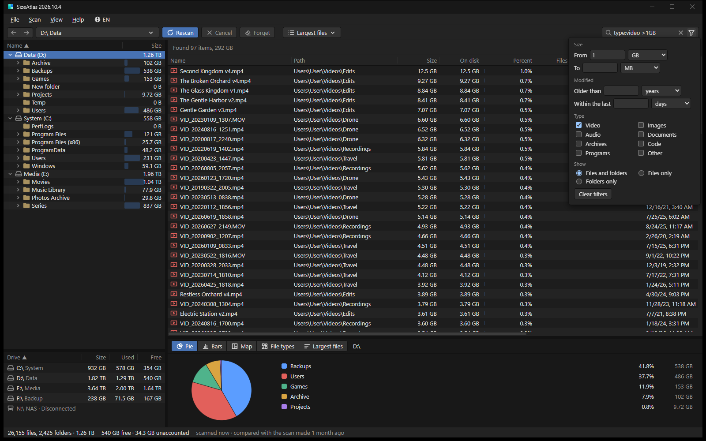
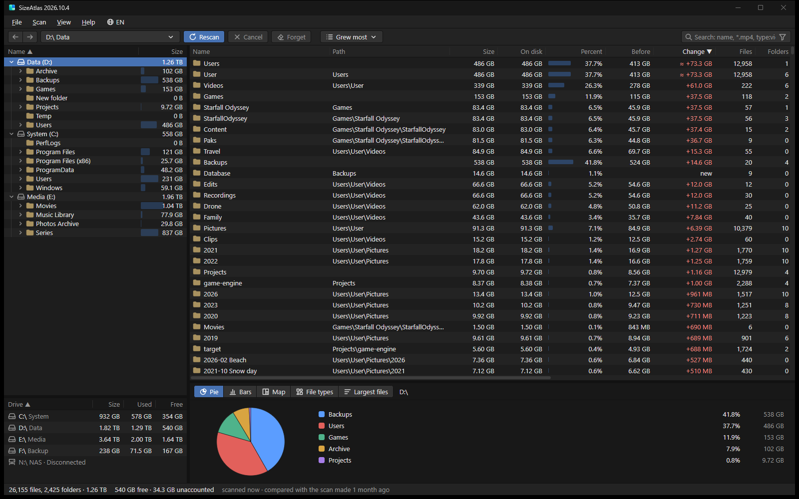
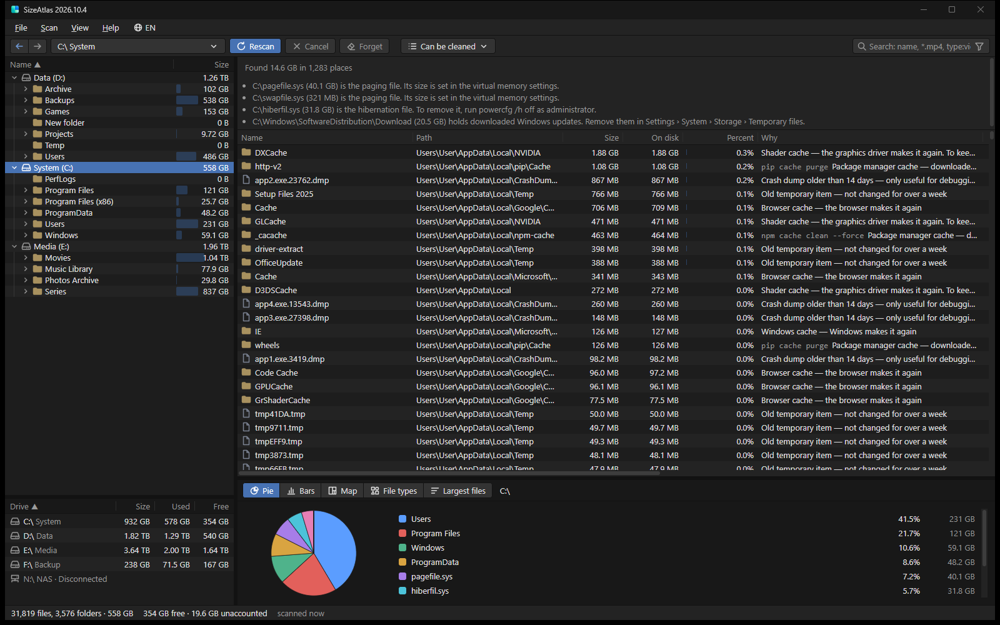

<h1> SizeAtlas</h1>


**Contents:** [What it does](#what-it-does) · [Install](#install) · [Languages](#languages) · [Using SizeAtlas](#using-sizeatlas) · [Benchmark](#benchmark) · [How sizes are counted](#how-sizes-are-counted) · [Moving to the trash](#moving-to-the-trash) · [Cleaning up](#cleaning-up) · [Finding duplicates](#finding-duplicates) · [Saved scans](#saved-scans) · [Updates](#updates) · [Building](#building) · [Releases](#releases) · [License](#license)

A cross-platform disk usage analyzer: see which folders and file types take up your disk space.

**Development notes, and a way to support the work if the app is useful to you:** 🤔😄🤗
[patreon.com/YGLabs](https://www.patreon.com/c/YGLabs).🤗


## What it does

> Work in progress.

- Scan drives and folders, and keep several of them side by side in one folder tree. The tree fills in while the first scan of a drive runs, and you can browse it meanwhile. Scans wait in a queue and run one at a time.
- See where the space goes: a sortable table of the current folder; lists of the largest, oldest, newest and empty items below it, and of the folders that grew most since the last scan; pie and bar charts, a treemap, file types and the largest files; free and unaccounted space of a drive.
- View a drive or folder as a living 3D island city: folders are districts, blocks and houses, free space is empty land and shore, and cars and residents move along the streets. Rotate and zoom the island, and click a house to select its folder in the tree.
- Search by name or extension, and filter the results by size, date and type.
- Refresh a single folder after a change, and move files and folders to the trash after a confirmation.
- Find known junk (caches, old temporary files, crash dumps) in two lists, **Can be cleaned** and **Check before deleting**, and move it to the trash or, on an explicit command, delete it for good.
- Find exact copies of files across all open drives and folders, and move the extra ones to the trash.
- Open items, show their properties and export the table to CSV. On Windows, restart as administrator to read every folder.
- The drives and folders that were open reopen at the next start.

Installers for Windows, macOS and Linux are on the [Releases](https://github.com/BeliyG3/SizeAtlas/releases) page.






## Install

Download the installer for your system from the [Releases](https://github.com/BeliyG3/SizeAtlas/releases) page. The installers are not signed, so the system warns you before the first start.

- **Windows:** the `.msi` or the setup `.exe`. If SmartScreen says that it protected your PC, click **More info**, then **Run anyway**. Smart App Control on Windows 11 blocks unsigned apps and shows no such button, so while it is on, the installer does not start.
- **macOS:** the `.dmg` for Apple silicon (`aarch64`) or Intel (`x64`); drag SizeAtlas to Applications. If macOS blocks the first start, open **System Settings › Privacy & Security** and click **Open Anyway**. If it says that the app is damaged, run `xattr -dr com.apple.quarantine /Applications/SizeAtlas.app`. To read every folder, SizeAtlas needs Full Disk Access; macOS resets it when you update an unsigned build, so grant it again after each update.
- **Linux:** the `.AppImage` (run `chmod +x` on it first; it may need `libfuse2`) or the `.deb`. Text in Chinese, Japanese, Korean, Thai, Hindi, Arabic and Hebrew may need the Noto fonts, which are the Debian/Ubuntu packages `fonts-noto` and `fonts-noto-cjk`.

| Platform | Status |
|---|---|
| Windows | Tested |
| macOS | Tested on the `.dmg` for Apple silicon (MacBook Air M2); the Intel build is untested |
| Linux | Untested |

**Versions** are calendar versions `YEAR.MONTH.N`. The first release of a month is shown as `2026.10`, the next ones as `2026.10.1`, `2026.10.2` and so on.

## Languages

The interface comes in 20 languages: Arabic, Chinese (Simplified), Dutch, English, French, German, Hebrew, Hindi, Indonesian, Italian, Japanese, Korean, Polish, Portuguese (Brazil), Russian, Spanish, Thai, Turkish, Ukrainian and Vietnamese. At the first start SizeAtlas follows the language of your system; change it in **View › Language**. Arabic and Hebrew use a mirrored, right-to-left interface, and Arabic shows numbers in Western digits. The translations are machine-made and were reviewed by several AI models. Corrections are welcome in [GitHub issues](https://github.com/BeliyG3/SizeAtlas/issues).

## Using SizeAtlas

- **Menu bar:** **File** has **Choose folder…**, **Export table** (see below) and **Exit**. **Scan** has **Scan** (the source picked on the toolbar), **Rescan** (the root of the selected folder, Ctrl+F5), **Refresh folder** (the current folder, F5; for the root it reads **Rescan**), **Cancel**, **Forget** and **Move to the trash…** (Delete). **View** has the size units (Auto, B, KB, MB, GB), **Drives panel**, **Chart** and **3D city**, which show or hide these panels, the theme (system, dark, light) and the language. **Help** has **About SizeAtlas**. Press Alt to move to the menu bar and back, or Alt and the underlined letter to open a menu. The arrow keys, Enter and Escape work in the menus, and while a menu is open, pointing at another title opens it.
- **Export:** **File › Export table** saves what the table on the right shows to a CSV file (UTF-8): every item of the current folder (not only the loaded rows) or the whole list, in the table's order, with a **Full path** column followed by the visible columns. Sizes, and **Before** and **Change** when shown, are in bytes (the change with its sign), and dates in local time. **CSV…** separates fields with commas, **CSV for Excel…** with semicolons, as Excel expects with Russian and other European regional settings. Ctrl+E repeats the last of the two. The "Unaccounted" row of a drive root is not exported. Excel treats a cell that starts with `=`, `+`, `-` or `@` as a formula, so be careful when you open an export of a folder whose file names you do not trust.
- **Toolbar:** open the source menu and pick a drive or a recent folder, then press the main button. It reads **Rescan** for the root of the selected folder, **Open** for another drive or folder in the tree or one with a saved scan, and **Scan** otherwise. **Choose folder…**, at the end of the source menu, scans any folder. Scans wait in a queue and run one at a time, and you can keep working while they run. **Cancel** stops the running scan, and **Forget** deletes the saved scan of the picked source, outdated ones included, and closes it if it is open.
- **Live first scan:** a root appears as soon as its top-level listing is read, with its own files and pending subfolders. Subfolders are scanned one at a time in name order, with a parallel walk inside each. Pending folders have no size; the current folder has a scanning marker and a growing size. Each completed folder becomes browsable with all its contents and final sizes. The tree and table update at most once every two seconds, and charts and the map at most once every five seconds; measured update cost can slow these intervals. Navigation and the final result remain immediate. You can browse, select, open items, copy paths and export during the scan. Refresh folder and Scan this folder are unavailable while a full scan of their root runs (first scan or rescan). Root files and completed folders can go to the trash during the scan; pending folders and the folder being scanned cannot. A queued rescan keeps the existing tree editable. Cancelling a first scan closes its partial tree without saving it; cancelling a rescan preserves the old complete tree. Only a completed scan is saved.
- **Back and forward:** the mouse side buttons, Alt+← and Alt+→ (on a Mac also Cmd+[ and Cmd+]), a two-finger swipe on a trackpad (right to go back, left to go forward; over a table that scrolls sideways, the swipe scrolls it until its edge first), or the arrows at the left of the toolbar go back and forward through the folders you visited, across roots; a folder of a root you closed is skipped, and a root that was rescanned opens at its top. In Arabic and Hebrew the directions are mirrored: Alt+→ and a swipe to the left go back, Alt+← and a swipe to the right go forward.
- **Left:** the folder tree and, below it, your drives with their size, used and free space. On Windows the list also has mapped network drives; one that does not answer is grayed out and shows **Disconnected** instead of sizes. Every drive or folder you open becomes a root of the tree, in the order you opened it, with a drive or folder icon. A root that is being scanned shows a spinner and the number of files found so far, and a root that waits for its turn shows **queued**. You can browse the other roots meanwhile, and a root you rescan stays as it was until the new scan replaces it. Right-click a root, or press Shift+F10, for **Rescan**, **Cancel scan**, **Close** (removes it from the tree and keeps its saved scan), **Forget** (deletes its saved scan and closes it), **Show in file manager** and **Copy path**. The tree lists folders only, sorted by name within each root until you click its Name or Size header (click again to reverse). Click the arrow next to a folder to expand or collapse it. Drag the tree's Name or Size header to swap the two columns. In the drives list, click a drive to select it and use the arrow keys to move. Double-click it or press Enter and a dialog asks what to do: **Scan** for a drive with no scan, **Open** or **Rescan** for a drive with a scan. A drive whose scan runs or waits is selected in the tree instead. Right-click a drive, or press Shift+F10, for **Scan** (**Rescan** if the drive has a scan), **Open** and **Forget**. Click a header of the drives list to sort it by that column (click again to reverse), and drag a header to move its column. Drag the border between the tree's Size and Name columns, or the border of the drives' Size, Used and Free columns on the side of the drive name, to resize them; double-click it to fit the column to its content.
- **Right:** the contents of the current folder. The table mode menu on the toolbar picks what the table shows: the current folder (**Folders and files** or **Folders only**) or a list of everything below it: **Largest files**, **Largest folders** or both, **Grew most** (see below), **Oldest** and **Newest** files, folders or both by the date modified, **Empty** folders, zero-length files or both by path, **Unreadable folders** by path, **Longest paths**, and the two clean-up lists, **Can be cleaned** and **Check before deleting** (see [Cleaning up](#cleaning-up)). A list holds the first 1,000 items, with the folder of each, relative to the listed folder, in the **Path** column. Click an item to select it in the tree, double-click a folder or press Enter to list that folder instead, and press Backspace or Alt+↑ to list the folder above. A header click sorts the 1,000 items. Click anywhere in a column header to sort by it, and click again to reverse the order. In the current folder, the old rows stay on screen, dimmed, until the new order arrives. Drag the border on the right of a header to resize its column, or double-click it to fit the column to its header and the rows on screen. Drag a header left or right to move its column: a copy of the header follows the pointer and a line shows where it will drop (Name always stays first). Right-click the header for **Size column to fit**, **Size all columns to fit**, a list of columns to show or hide (Name cannot be hidden) and **Reset columns**, which restores the default order, widths and columns. The borders can also be reached with Tab: the arrow keys resize (Shift for bigger steps) and Enter fits. In the current folder, double-click a folder or press Enter to open it, and with the table focused, press Backspace or Alt+↑ to go up.
- **Refresh and trash:** after a change on disk, right-click a folder and choose **Refresh folder**, or press F5 for the current folder: only that folder is scanned again, in the queue, while the rest of the tree stays as it was and you can keep working. The refreshed folder and its parents stay expanded in the tree; folders inside it collapse. F5 on the root, or Ctrl+F5 anywhere, scans the whole root again. In the table and in lists, Ctrl+click adds or removes a row (on a Mac, Cmd+click works like Ctrl+click), Shift+click and Shift with the arrow keys select the rows from the last one you clicked, and Ctrl+A selects every loaded row (in a list, all of them). The selected rows clear when you select another folder or when the table mode, the sort or the tree changes. **Move to the trash…** in the context menu, Delete or **Scan › Move to the trash…** asks first: the dialog lists up to ten full paths, the total size and the date of the scan, and Cancel has the focus. In the tree, Delete moves the folder in focus. With several rows selected, the menu item reads **Move N items to the trash…** and **Copy paths** copies one path per line (with one row, the menu shows **Copy path**). SizeAtlas deletes for good only on an explicit command in the two clean-up lists, after two red confirmations (see [Cleaning up](#cleaning-up)); everything else goes to your system's trash. SizeAtlas has no undo: restore items from the trash, then refresh the folder. On a Mac keyboard without a Delete key, press Fn+Backspace.
- **What changed since the last scan:** after a full scan of a drive or folder (the first scan or **Rescan**), SizeAtlas compares it with the previous full scan of the same root, by the size on disk. The very first scan of a root has nothing to compare with. The table then has a **Change** column: `+12.4 GB` or `−3.1 GB`, **new** for an item that was not there, `?` for a folder that could be read in only one of the two scans, `≈` before a figure that is approximate (it includes such a folder, or one of the two scans has approximate sizes), and nothing when the size did not change. The column is shown by default only when the root has a previous scan; show or hide it like the others. **Grew most** in the table mode menu lists up to 1,000 folders below the listed folder with the largest change, up or down, with the **Before** and **Change** columns, sorted by change. A folder that is gone is tagged **deleted** (only the topmost one of a deleted tree); it cannot be opened or moved to the trash, and you can only copy its path. While the comparison runs, the list says so; without a previous scan, it says that instead, and a rescan fills it. The status bar adds when the previous scan was made. Refreshing a folder (F5 on a folder; F5 on the root is a **Rescan**) and moving items to the trash do not change what SizeAtlas compares with: that is always the previous full scan. So a file you moved to the trash through SizeAtlas shows as a shrinkage of its folder. Cancelling a scan changes nothing.
- **Open, Properties, Scan this folder:** the context menu of one item also has **Open** (a file opens in its default program, a folder in the file manager; double-click or Enter on a file does the same), **Properties** (the system dialog; Windows only) and, for a folder, **Scan this folder**, which queues a full scan of it as a new root of the tree. **Open** launches whatever the item is, programs included, so use it only on items you trust.
- **Search:** the field near the end of the toolbar (Ctrl+F, Cmd+F on a Mac) lists the files and folders below the current folder whose names match. Words match any part of the name, in any case, and a name must contain all of them. Masks with `*` and `?` match the whole name (`IMG_*`), and extensions (`.mp4 .mkv`) match files only; a name has to match at least one mask or extension. Words can also set conditions, alone or next to a name, and all of them have to hold: a size (`>1GB`, `<10MB`, `100MB..1GB`; units B, KB, MB, GB and TB of 1024, a fraction like `1.5GB` is fine, and a space before the unit is too), a modified date (`older:1y`, `newer:30d`; the units are `d`, `w`, `m` for 30 days and `y` for 365), a file type (`type:video`, `type:images`, `type:archive`, `type:code`, `type:programs`; repeat it to allow several), and `files` or `folders`. For example, `type:video >1GB older:1y` finds videos over a gigabyte that have not been touched for a year, and `folders >10GB` lists the big folders. The size is the size on disk, and a folder counts with everything in it; a type matches files only. A word that is not a valid condition, such as `>` or `type:foo` while you are still typing, is searched as part of the name. `>` and `<` are strict, while `>=`, `<=` and ranges include the value; the keywords are not case-sensitive. A file or folder whose modified date is unknown matches neither `older:` nor `newer:`, and `folders` together with `type:` finds nothing. The Filters button in the field opens a panel that shows the conditions already typed and writes its changes into the text: From and To include the value (`>=` and `<=`, or `100MB..1GB` for both), and a change moves the conditions after the name words, one of each kind, so a strict `>` or `<` you typed becomes inclusive; the name words stay as they are. The search text takes up to 256 characters, and the panel does not add a condition that would not fit. Press Enter to search at once, the Down arrow to move into the results, and Esc or the cross to clear the field. The results replace the table, largest first, until you clear the field or pick a table mode. The line above them gives the number and the total size of all matches; a folder is counted once, and what is inside it is not added to the size again. Enter or a double-click on a folder leaves the search and opens it.
- **Bottom:** charts of the current folder, one at a time: **Pie**, **Bars**, **Map** (a treemap), **File types** and **Largest files**. Click a slice, bar or rectangle to select it: a folder opens, a file is selected in its folder. In **File types**, click a type to highlight its files in the map. The status bar shows the number of files and folders of the selected root, its size, for a drive its free and unaccounted space, and when the scan ran. While a scan runs, its right side shows the root, the files found so far and the folder being read.
- **3D city:** **View › 3D city**, or the city button after the search field, shows the whole drive or root of the selected folder as an island city in a panel on the right. The largest folders become districts, their subfolders blocks and houses, and the smaller folders of a block share low filler houses; the area of each part grows with its size. The free space of the drive is empty land inside the city (plazas and vacant lots) and a band of shore. Highways cross the island, a ring road runs around the centre, and streets and lanes lead between the blocks; some islands are cut by a canal with bridges. Gates with bridge stubs on the shore face the other scanned drives and folders. Cars drive along the roads, some fly above them, and residents walk on the sidewalks and lanes. The folder selected in the tree is outlined and the rest of the island is dimmed. Drag to rotate, drag with the right or middle button to pan, and use the wheel to zoom. Point at a house to see its folder, path and size, click it to select it in the tree, or double-click it to fly to it. The island is drawn at most 30 times a second and not at all while the panel is hidden; during a scan it is rebuilt at most once every 5 seconds. **Reset view** shows the whole city again. While the selected root has no scan yet, the panel asks you to select a drive or folder that has one. The city needs WebGL 2; without it, the panel says that the 3D view is not available.

Drag the borders between the panels to resize them. SizeAtlas remembers the open roots and the selected one, panel sizes, column widths, the order and visibility of the table columns, the order of the tree and drives columns, the drives sort, the table mode, whether the drives panel, the chart and the 3D city are shown, the chart, units, theme and language.

| Column | Meaning | Sortable |
|---|---|---|
| Name | Name of the folder or file | Yes |
| Path | In a list: the folder of the item, relative to the listed folder | In lists |
| Size | Combined length of the files, before rounding to disk space | Yes |
| On disk | Space the files take on disk (see below) | Yes (default, largest first) |
| Percent | Share of the current folder, on disk | Yes, like On disk |
| Before | In a list: the size on disk in the previous full scan | In lists |
| Change | Change of the size on disk since the previous full scan | Yes |
| Files | Files at any depth | Yes |
| Folders | Folders directly inside | No |
| Subfolders | Folders at any depth | Yes |
| Created, Modified, Accessed | Dates from the file system | Modified only |
| Attributes | Windows: `D` folder, `R` read-only, `H` hidden, `S` system, `A` archive, `C` compressed, `E` encrypted, `I` not indexed, `O` offline, `P` sparse, `L` link. macOS and Linux: permissions such as `drwxr-xr-x` | No |
| Owner | Account that owns the item | No |

In a list, every column except Created, Accessed, Attributes and Owner sorts.

SizeAtlas reads Created, Accessed, Attributes and Owner from the disk only for the rows on screen, and only while one of these columns is shown, so they appear a moment after you scroll. A dash means it could not read the value.

## Benchmark

```bash
cargo run -p sizeatlas-core --release --example scan -- <path> [--live] [--twice] [--edit]
```

`--live` measures first-scan batches and preallocated grafts; without it the parallel whole-root walker is measured. `--twice` keeps the first result in memory while scanning again, to measure peak memory of a rescan. `--edit` removes the largest folders until most of the tree is gone and compacts it, as a large trash or refresh does, saving the cache before and after. On the Windows machine below, compacting took 0.05 s and saving the cache 1.19 s.

Results of milestone M0 (release build, warm file system cache, no administrator rights):

| Machine | Scanned | Objects | Scan | Peak memory | Cache file | Cache load |
|---|---|---|---|---|---|---|
| Intel i9-13900K, Samsung 990 PRO 4 TB, Windows 11 (NTFS) | `C:\`, 3.5 TiB | 8.2 million | 18 s | 1.6 GiB | 86 MiB | 1.4 s |
| Apple M2, 8 GB RAM, macOS 27 (APFS) | `/`, 304 GiB | 1.8 million | 13 s | 0.5 GiB | 17 MiB | 0.16 s |

The first run on Windows, with a colder cache, took 26 s. For reference, WizTree 4.33, which reads the NTFS master file table directly and needs administrator rights, scanned the same drive in 23 s.

## How sizes are counted

SizeAtlas reports the space files take on disk. Folder totals of hard-linked files can differ between a first scan and a rescan; the root total is the same.

- **Windows:** file length rounded up to whole clusters. Compressed and sparse files count their allocated size.
- **macOS and Linux:** allocated blocks. A file with several hard links is counted once. Other mounted file systems are not entered.
- Files that exist only in the cloud (OneDrive on Windows, iCloud Drive on macOS) count as 0, and cloud-only folders are not opened.
- Symbolic links and junctions are never followed.

When you scan the root of a drive, SizeAtlas also shows its free space and the **unaccounted** space: space the drive reports as used that the scan did not find. It includes system files, folders you cannot read, the Windows Recycle Bin and, on macOS, other volumes of the same APFS container. Items you move to the trash keep their space until you empty the trash, so the unaccounted space grows meanwhile.

Known limitations:

- On Windows, a file with several hard links is counted once per name, so folders such as `C:\Windows\WinSxS` or package stores that use hard links can look larger than they are.
- On Windows, very small files stored inside the master file table are counted as one cluster.
- Folders you cannot read, such as `System Volume Information` without administrator rights, are not counted. From the banner you can restart SizeAtlas as administrator on Windows to rescan the root, or open the Full Disk Access settings on macOS; **Show** lists the unreadable folders of the root. As administrator, SizeAtlas also enables the backup privilege to read system folders; some may stay unreadable even then. On macOS, some system folders stay unreadable even with Full Disk Access, as macOS protects them from every app: the banner then says that access is on.
- Windows container layers (`ProgramData\Microsoft\Windows\Containers\Layers`) are skipped: they mostly mirror system files, and reading them through their filter driver made a full scan about five times slower.
- On macOS, APFS clones are counted once per copy.
- On Windows, files compressed with WOF (CompactOS, `compact /exe`) are counted at their full length, because Windows does not mark them as compressed in directory listings.
- On Linux, btrfs subvolumes that are not separately mounted are skipped, because each has its own device id.
- Every open root is kept in memory: a drive with about 8 million objects takes about 1.6 GiB, and a rescan briefly holds two trees. Close a root to free its memory.

## Moving to the trash

Before anything moves, SizeAtlas checks that every item is still what the scan saw: a file or a folder with the same date modified. If one of them changed, nothing moves and SizeAtlas asks you to refresh the folder (F5). Each item is checked again right before it moves. Known limits of this check:

- An item that changes between the check and the move still goes to the trash: the system takes a path, not the item the check saw. The gap is short, and you can restore the item from the trash.
- The check compares the type and the date modified, not a file id, so a copy put back in place with the same date passes it.
- Right after a change, the folder listing can lag behind the date of the item itself for a moment, so an item changed just before the scan may be reported as changed. Refresh the folder and try again.
- The listing can also keep the old date for longer: a file kept open for writing can show its old date as long as it stays open. Such an item passes the check, and you can restore it from the trash.

On Windows, SizeAtlas moves an item only where the Recycle Bin takes it:

- the item is on a fixed drive, and no policy turns the Recycle Bin off;
- the Recycle Bin of that drive is turned on;
- the item fits in that Recycle Bin: in the size limit Windows reports or, when Windows reports none, in 5 % of the drive. SizeAtlas compares the limit with the larger of the size on disk and the length, so cloud-only and compressed files count in full.

A `subst` drive is judged by the real drive behind it. If SizeAtlas cannot read these settings, or Windows would delete the item for good, the item stays where it is and SizeAtlas says so. On macOS, a volume without a trash is expected to report an error for each item.

While items move to the trash, scans of the same drive wait, and so can a scan of another drive queued behind one of them (scans run one at a time); with many items this can take minutes on Windows. During a first scan, root files and completed folders can go to the trash, but pending folders and the folder being scanned cannot. During a rescan, the old tree stays editable: an item the rescan listed before it went to the trash is left out of the new tree. While a folder is refreshed, neither the folder, nor anything inside it, nor the folders above it can go to the trash; the rest of the root can. While a drive or folder has its first scan, the items of another open root inside it cannot go to the trash either. Where the trash is unavailable, the menu item is disabled and its tooltip says why, and a selection that includes such an item does not go at all. A rescan waiting in the queue keeps its existing tree editable. Closing the window while items move waits for the item that is moving, cancels the removals that wait and saves the scan; the items left stay where they are.

You can confirm another removal at any time. Removals on different drives run at the same time; on one drive they run one after another, in the order you confirmed them, and their rows are tagged **queued…** until their turn. The status bar shows the first two running removals (the folder they work in, how many items have gone and the name of the item that moves now) and `+N` for the rest, and their rows are dimmed. A request of more than 20 items also gets its own small progress window, which leaves the rest of the app usable. **Stop** (in that window, or in the status bar for a few items) ends that removal after the item that is moving and cancels the removals waiting on the same drive: the items moved so far stay in the trash and leave the tree, the rest stay where they are. A message then says how many items went and their size, where Stop left the request, and how many waiting removals it cancelled. An item that a removal already has, running or waiting, cannot be removed again; refreshing a folder of a root whose items move is unavailable until it ends, and the tooltips say so.

## Cleaning up

Two table modes list known junk below the listed folder, from the finished scan: up to 1,000 rows, largest first, with a **Why** column that says what each row is and what deleting it costs. Above the rows, a line gives the total, with `≈` when part of it could not be read. Under it are facts that are not rows and are never deleted: the paging and hibernation files, Windows update leftovers (remove them in **Settings › System › Storage › Temporary files**), caches that only their tool can clean safely (uv, pnpm, Yarn Berry, with the command), folders that need administrator rights and apps to close first. When the scan is more than a day old, the list says so: rescan for an exact list.



- **Can be cleaned:** what well-known cleaners such as BleachBit remove without asking. Items in `%TEMP%` not changed for more than 7 days and up to 1 GB (`%SystemRoot%\Temp` too, as administrator and with no restart pending); crash dumps older than 14 days; Windows error reports; the Internet cache, without `Content.Outlook` and `Content.MSO`; the DirectX shader cache and those of the NVIDIA, AMD and Intel drivers; the caches of Chrome, Edge, Yandex, Brave, Vivaldi, Opera and Firefox; the caches of Discord, Slack, the Steam browser and VS Code; the package caches of npm, pip, NuGet, Cargo, Yarn and Go; `__pycache__` folders that hold nothing but bytecode.
- **Check before deleting:** what comes back only at the cost of time or a download, or may still be needed. `node_modules` next to a `package.json` and Python virtual environments (**Why** says whether a lock file next to it can restore it), the Gradle cache, the Discord `Cache` (your favorite GIFs go with it), crash dumps younger than 14 days, and `%TEMP%` items older than 7 days that are larger than 1 GB or look like work in progress (a `.blend`, `.psd`, `.kra` or `.xcf` file, Office `~$` files, a `.git` folder, a project file such as `package.json`). Ctrl+A in **Can be cleaned** never takes these rows.
- The caches of a browser or an app are rows only while it is closed; otherwise a line asks you to close it. npm, pip and Gradle count as running by their command line, not by the name `node`, `python` or `java`, which other tools run all the time.
- `node_modules`, virtual environments and `__pycache__` are never looked for in AppData or in the dot-folders of your home folder (such as `~/.vscode`), where extensions and apps keep live copies.
- On macOS and Linux, short fixed lists of caches apply: the package caches of npm, pip and Cargo; on macOS also the Go and Homebrew caches, the caches of Chrome and Firefox, the VS Code update cache, Xcode `DerivedData` (to check) and old diagnostic reports; on Linux, of `~/.cache`, only `thumbnails`, `mesa_shader_cache`, `mesa_shader_cache_db` and the `cache2`, `Cache`, `Code Cache` and `GPUCache` folders of Firefox, Chrome, Chromium, Brave, Edge and Vivaldi. There, no rule looks for `node_modules`, virtual environments or `__pycache__`.

**Never offered**, in either list and whatever folder you list. A folder that holds one of these at any depth is not offered either:

- cloud folders (OneDrive, Dropbox, Google Drive, iCloud), cloud-only files, and folders that could not be read or are still being scanned;
- work in progress and recovery data: `%TEMP%\claude` and the work folders of other AI tools, `%TEMP%\Low`, `~/.claude`, `~/.codex`, `~/.cursor`, local editor history, the temporary folders of SizeAtlas itself;
- installed tools and package stores: `%APPDATA%\npm`, `%LOCALAPPDATA%\Programs`, `WindowsApps`, `%LOCALAPPDATA%\Packages`, `npm-cache\_npx`, uv, pipx, conda environments and packages, the pnpm store, `.nuget\packages`, nvm, fnm and Volta;
- browser data other than the cache: cookies, passwords, history, bookmarks, sessions, extensions and site storage;
- secrets: `.ssh`, `.gnupg`, `.npmrc`, `.pypirc`, `NuGet.config`, `.git-credentials`, and the Windows `Credentials`, `Vault`, `Protect` and `Crypto` folders;
- mail and messengers: `*.pst`, `*.ost`, the Thunderbird profile, Telegram `tdata`, the Local Storage of Discord and Slack;
- virtual disks (`*.vhd`, `*.vhdx`), virtual machine images and the Defender quarantine;
- models, wherever they are: `huggingface`, `lm-studio`, `.ollama`, `models--*`, `*.gguf`, `*.safetensors`, `*.ckpt`, and `~/.cache/torch`;
- what chkdsk recovered (`found.000`, `*.chk`), which may be your files;
- system folders, your libraries (Desktop, Documents, Pictures, Music, Videos, Saved Games, Downloads), Steam games and `userdata`, iOS backups, other users' profiles, `Program Files` and `ProgramData` outside the rules above; on macOS `~/Library/Application Support`, `Containers`, `Mail`, `Messages`, `Photos`, `Mobile Documents`, `Safari`, the `com.apple.*` caches and Time Machine; on Linux `/etc`, `/usr` and `/var/lib`.

`torch` and the Windows `Credentials`, `Vault`, `Protect` and `Crypto` names count only at these known places, so that a `site-packages/torch` does not hide every virtual environment. Project files such as `package.json` block nothing: they only mark `%TEMP%` items as work in progress.

**Before anything goes**, SizeAtlas checks the rows again. Each one must still be a row of one of the two lists, judged by the apps running now: a browser started after the list was made keeps its cache. Right before each row goes, its contents are read again from the disk. A protected name added since the scan, something unreadable or a cloud placeholder keeps the row where it is, and so, on macOS and Linux, does a file of another user, a socket, a FIFO or a device, which the list itself cannot see. A `%TEMP%` row must still be older than 7 days by the latest of its modified, created and changed times. If any item of a request is no row, nothing goes.

**Move to the trash** stays the default: Delete and **Move to the trash…** work as everywhere. The dialog adds that the space is freed only when you empty the trash and, on Windows, when the rows take more than the free space of the Recycle Bin, that Windows will delete its oldest files for good. A row larger than the whole Recycle Bin stays where it is.

**Delete permanently** exists only in these two lists: **Delete permanently…** in the context menu, in red, or Shift+Delete in the table (Fn+Shift+Backspace on a Mac keyboard without a Delete key). A red dialog lists up to ten paths and the total and says that this cannot be undone; a second one asks again with the number of items and their size. Cancel has the focus in both and works at once. The second red button takes a press only half a second after it appears, so neither a double click nor a key held down from the first dialog answers the second, and Cancel or Escape in either one deletes nothing. The items go one at a time, with progress and **Stop** as for the trash; a link inside a row goes as a link, and its target stays. In the other table modes, in the tree, in the charts and in the treemap there is no such item, and Shift+Delete does nothing.

**Copy clean-up command**, in the menu of a package cache, copies the tool's own command, such as `npm cache clean --force`. You run it yourself, and it deletes at once, without the trash.

Known limitations:

- When Windows reports no size limit for a Recycle Bin, SizeAtlas takes 5 % of the drive. This applies to every move to the trash: a larger item stays where it is.
- The macOS and Linux rules are checked only by automated tests, not on real macOS or Linux systems. On Linux, `/var/tmp` is not cleaned.
- After a restart as administrator under another account, the lists show the caches of that account, not yours.
- Without administrator rights, SizeAtlas cannot read the command lines of programs that run as administrator, so npm, pip or Gradle started that way may look closed.
- Running apps are read once per request, by process name, not by open files. An app started during a long request, or a file kept open in an old `%TEMP%` folder, can leave a row partly deleted; SizeAtlas then says what stayed.
- A folder deleted for good only in part keeps its old size in the tree until you refresh it.

## Finding duplicates

The **Duplicate files** table mode finds exact copies from the trees already in memory. **Find** searches the folder selected in the tree; select a drive to search all of it. With **In all open drives and folders** on, it searches every open drive and folder, to find copies across drives. If **Find** would now search somewhere other than the result shown, for example after you select another folder, a line in the header says where. Until the selected drive or folder has a tree, **Find** searches every open drive and folder, and the same line says so. It reads files only when you press **Find**, after showing how many files and bytes it will compare. Groups are on the left, largest saving first; the selected group's copies are on the right, with paths and a thumbnail. Their columns work as in the main table: click a header to sort, drag it to move the column, drag its border to resize, and right-click it to fit, show or hide columns.

- **Compared:** regular files of 4 KB or more, by length, first and last bytes, then a full BLAKE3 hash. Groups appear as they are confirmed; **Cancel** keeps them, and **Continue** resumes.
- **Background:** the search reads at low priority, so the computer stays responsive while it runs.
- **Filters choose starting files:** the search field here is a filter, not the usual search. A group is listed if any of its files matches and shows all its copies, so `older:1y` or a name never splits it; a size condition fits every copy alike. The field starts as `type:image`; clear it to see every type.
- **Left out:** system and program folders (Windows: `Windows`, `Program Files`, `ProgramData`, `AppData`; macOS: `/System`, `/Library`, `/Applications`, `~/Library`, app and photo-library package contents, and iCloud Drive; Linux: `/usr`, `/opt`, `/var` and similar), `node_modules`, `.git`, Python environments, `steamapps` and the dot-folders of your home folder. **Include system folders** adds them; their copies are tagged and never go to the trash. Programs and games elsewhere are not recognized.
- **Counted once:** a path reached through overlapping roots (such as `C:\` and a folder on it), and hard links. A file also linked outside the search is tagged, not counted as freed and not removed. A cloned volume keeps the same file ids, so its files are neither merged with the originals nor removed.
- **Not read:** cloud-only files (never downloaded; counted with changed and unreadable files) and roots still being scanned (the list names them). If the searched trees change mid-search (a rescan, a refresh or a removal), the search cancels itself, and a finished result is marked out of date: press **Find** again. A search of all open drives and folders is also cancelled or marked out of date when another root opens or finishes its first scan; a folder search is not.
- **Can be freed:** the size on disk of all copies but the largest. It says "up to" because APFS and ReFS clones, which share their data, are not recognized.

**Viewing a picture.** The preview picture fits its area and is never enlarged beyond its size; drag the border below it to resize. The wheel zooms the preview at the pointer, a drag pans it, and a double-click switches between fitting it and its actual size. Hover a group's thumbnail for a moment to see a larger picture.

- **Full screen** (the button): the same wheel, drag and double-click, plus **Fit** and **Actual size** buttons. ← and → go to the previous and next group with a picture. Esc, or a click on the dark area, closes the view.
- **Separate window:** a second window that shows the picture of the selected group and follows the selection.
- **Open** and, on Windows, **Open with…** (also in the copy's context menu) act on the copy under the cursor in the copies table, or on the first copy in the table when no copy has the cursor.

**Removing copies.** Mark copies and choose **Move to the trash…**. They go only to the trash, never for good. One copy always stays: nothing moves unless at least one unmarked copy, outside the system folders and known to be a separate file, is left. The [Moving to the trash](#moving-to-the-trash) rules apply too.

- The kept copy is first read in full again and must still match its hash. On Windows it is held open without write or delete sharing until the last copy moves, so nothing can change, rename or delete it (a change to its times is still reported). macOS and Linux have no such lock: SizeAtlas checks its length, time and identity afterwards and warns on a mismatch.
- Removed copies are checked only by length and modification time, so an overwrite that keeps both goes unnoticed; the copy can still be restored from the trash.
- A removal waits for earlier removals on the drives of all its copies, the kept one included. If those changed the roots, it is refused and you have to **Find** again.
- Thumbnails cover the formats the app's web view displays (JPEG, PNG, GIF, WebP, BMP, SVG, ICO, AVIF); other files get an icon of their type. A thumbnail is read from a copy that is not on a hard disk drive when the group has one, so a sleeping hard drive is not woken just to show the list.

Known limitations:

- A read from an unresponsive network drive may not cancel at once.
- Stopping a removal queued for a drive takes effect only at its turn.
- A removal waits for every open root holding the kept copy, except a root the search skipped as still scanning, whose drive SizeAtlas has not looked up yet. There, the held copy still cannot be deleted on Windows; elsewhere the warning above applies.
- The result stays in memory until you close the app, and so do the hashes of the files read (about 150 bytes per file), so a later **Find** does not read unchanged files again.
- Only exact copies of 4 KB or more are found, not resized or re-saved pictures.

## Saved scans

SizeAtlas saves each scan to the app data folder. At the next start it reopens the drives and folders that were open, in the same order, and selects the one that was selected:

- Windows: `%APPDATA%\app.sizeatlas\scans`
- macOS: `~/Library/Application Support/app.sizeatlas/scans`
- Linux: `~/.local/share/app.sizeatlas/scans`

Each root keeps up to three files there: the current scan (`.bin`), the last full scan (`.full`) and the full scan before it (`.base`), which **Change** and **Grew most** compare with. **Forget** deletes all three; **Close** deletes none. A file that cannot be read, or that belongs to another root or was made with other size settings, gives no comparison instead of wrong numbers.

A saved scan that cannot be read any more is skipped, with one message for all of them. Scans that were still running or waiting are not restarted.

Each file records the version of the cache format. The source menu and the drives panel label a scan saved by an older version of SizeAtlas as **saved by another version**. Scan the drive or folder again to replace it.

## Updates

Once a day, at startup, SizeAtlas asks GitHub for the latest published release of [BeliyG3/SizeAtlas](https://github.com/BeliyG3/SizeAtlas). GitHub sees your IP address; nothing else is sent. If a newer version is out, a banner offers **Download**, which opens the release page in your browser; close the banner and that version is not offered again. SizeAtlas never downloads or installs anything itself. Turn the daily check off with **Help › Check for updates automatically**, or check at any time with **Help › Check for updates**. **Help › SizeAtlas on GitHub** and the link in **Help › About SizeAtlas** open the project page.

## Building

### Requirements

- [rustup](https://rustup.rs). The pinned Rust version (1.94) is installed automatically from `rust-toolchain.toml`.
- Node.js 24 (see `.nvmrc`).
- Windows: WebView2 (included in Windows 11).
- Linux: `libwebkit2gtk-4.1-dev build-essential curl wget file libxdo-dev libssl-dev libayatana-appindicator3-dev librsvg2-dev`.

### Run

```bash
npm ci
npm run tauri dev
```

Build an installer for the current OS:

```bash
npm run tauri build
```

### Checks

```bash
npm run build
cargo fmt --all --check
cargo clippy --workspace --all-targets --locked -- -D warnings
cargo test --workspace --locked
npm run lint
npm run typecheck
npm test
```

`npm run build` comes first: the Tauri crate embeds the built UI from `dist/`.

## Releases

1. Set the version in `package.json`, `core/Cargo.toml` and `src-tauri/Cargo.toml` to `YEAR.MONTH.N`: `2026.11.0` for the first release of November, `2026.11.1` for the next one. Set the MSI version in `src-tauri/tauri.windows.conf.json` to `YY.MM.N`: `26.11.0`. Update the lock files with `npm install --package-lock-only` and `cargo update --workspace`, and commit.
2. Tag the commit with `v` and the version as it is shown, `v2026.11` or `v2026.11.1`, and push the tag: `git push origin v2026.11`.
3. The Release workflow checks that the tag matches the version, builds the installers on Windows, macOS (Apple silicon and Intel) and Linux and attaches them to a draft release. Check the draft and publish it by hand.

The installers are named after the shown version, such as `SizeAtlas_2026.11_x64-setup.exe`. The MSI installer has its own version `YY.MM.N`, because Windows Installer allows at most 255 in the first number; the workflow stops if it does not match.

## License

MIT

The residents of the 3D city are the walking figure from [Universal Base Characters](https://quaternius.com) by Quaternius, released under CC0.
